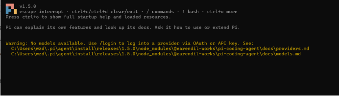
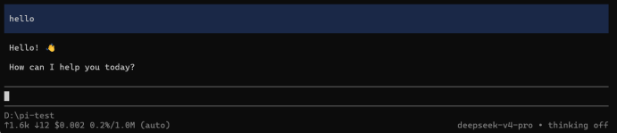
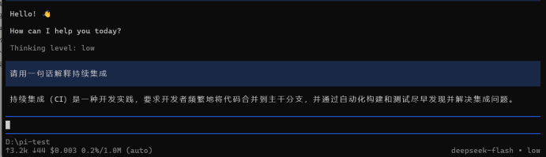
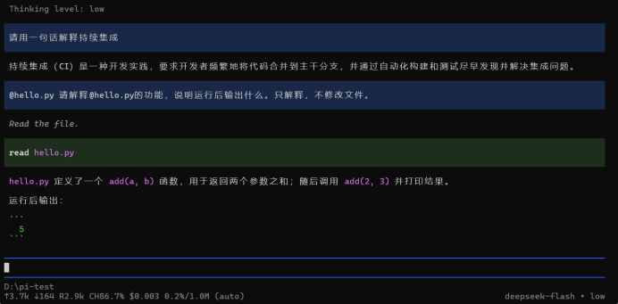
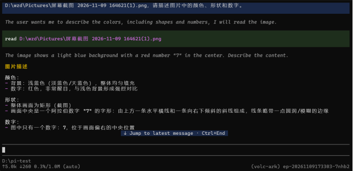
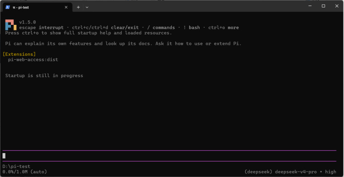
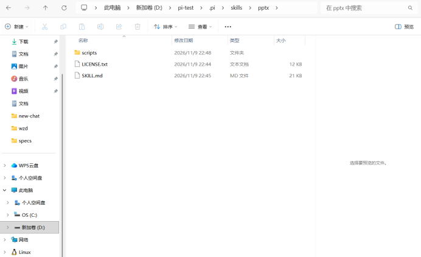
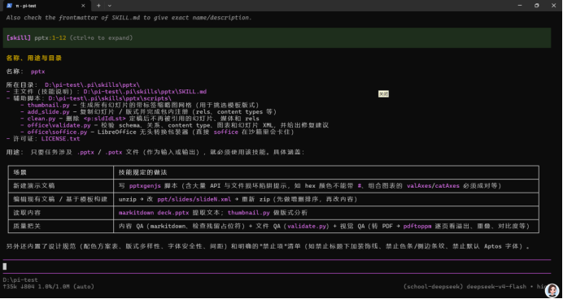

# 实践课1：Pi Agent 安装与使用
## 基本信息
- 姓名拼音：wangziduan
- GitHub登录名：kilig036
- 完成时间：2026‑11‑13
- Pi工作目录：`D:\pi‑test`
- PPT Skill路径：`D:\pi‑test\.pi\skills\pptx`

## 任务一：本地安装并启动

## 任务二：配置模型并完成会话
> 说明：在Pi终端执行`/login`，选择API Key登录方式，配置deepSeek-v4-pro模型。

## 任务三：切换模型与模型思考级别
> 说明
1. **思考级别切换**：使用`/thinking`命令控制推理等级，将思考级别切换为`low`。
2. **模型切换**：使用`/model`快捷键打开模型选择器切换为deepseek-flash。

## 任务四：引用代码文件与粘贴图片测试
### A. 使用 @ 引用代码文件
> 说明：在`D:\pi‑test`目录创建`hello.py`，代码为简单加法函数。在Pi输入框输入`@`选中`hello.py`文件，发送提示：`请解释@hello.py的功能，说明运行后输出什么。只解释，不修改文件。`。Pi成功读取文件，正确解析add函数逻辑，给出运行输出结果5。

### B. 粘贴小图片并测试
> 说明：使用画图工具绘制浅蓝色背景、带红色数字7的200×200小图，复制图片至剪贴板，终端内使用`Alt+V`粘贴图片附件，发送提示`请描述图片中的颜色、形状和数字。`。模型成功读取剪贴板图片，识别背景颜色、矩形画面以及数字7。

## 任务五：安装并使用Pi Packages插件
> 说明：从 https://pi.dev/packages 选取`pi‑web‑access`网页访问插件。
执行项目本地安装命令：`pi install npm:pi‑web‑access -l --approve`，安装完毕完全退出Pi会话，在`D:\pi‑test`重新执行`pi`启动，启动日志`[Extensions]`区块出现`pi‑web‑access:dist`代表插件加载成功。
测试指令：`请获取https://pi.dev/packages/pi‑web‑access的页面标题`，插件调用fetch工具，成功抓取网页标题`Pi Web Access`。

## 可选任务六：安装PPT Skill
> 说明：从 `anthropics/skills`仓库拉取完整`skills/pptx`目录，放置到项目路径`D:\pi‑test\.pi\skills\pptx`，目录内完整保留`SKILL.md`、`LICENSE.txt`、scripts脚本文件夹。
完全退出Pi，重新在`D:\pi‑test`启动Pi，客户端自动扫描发现pptx Skill。执行调用命令：
`/skill:pptx 请说明这个 Skill 的名称、用途和所在目录`，Pi读取SKILL.md，输出技能名称、本地路径、PPT创建/编辑相关功能说明。
> 备注：本次仅完成**文件部署、Skill发现、调用验证**，未配置python、pptxgenjs依赖，未做实际PPT文件生成。

