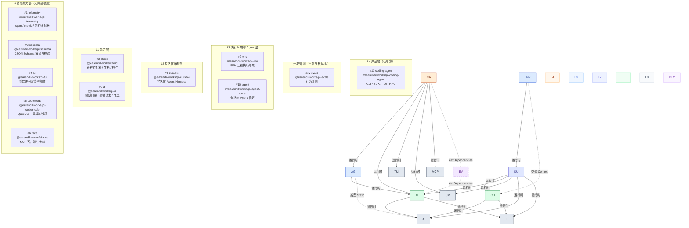

# 实践课2：组织建仓与源码分析

> 姓名拼音：\*\*\[wangziduan]\*\*　学号：\*\*\[202430224080]\*\*　日期：2026-11-23
> 分析对象：Pi monorepo（`pi-hunnu-2026`），11 个指定模块 + 实际存在的 `evals` 包。
> 本地 HEAD：`c3cc91632d0a1950fb122605b190233f2aa0006e`，所有包版本 `1.5.2`。

## 1\. 源码获取

### 1.1 组织仓库与 clone 信息

**图 1　组织/课程仓库页面**

!\[组织仓库截图](images/01-org-repo.png)

实际 clone 地址（文本）：

```text
https://gitee.com/pinhaodui/pi-hunnu-2026.git
```

clone 命令：

```bash
git clone https://gitee.com/pinhaodui/pi-hunnu-2026.git
cd pi-hunnu-2026
```

**图 2　本人 clone 后的仓库信息**

!\[clone 信息截图](images/02-clone-info.png)

### 1.2 源码目录

**图 3　源码目录**

!\[源码目录截图](images/03-source-tree.png)

实际 `packages/` 下有 12 个目录：

```text
packages/
├── agent/          # @earendil-works/pi-agent-core
├── ai/             # @earendil-works/pi-ai
├── chord/          # @earendil-works/chord
├── codemode/       # @earendil-works/pi-codemode
├── coding-agent/   # @earendil-works/pi-coding-agent
├── durable/        # @earendil-works/pi-durable
├── env/            # @earendil-works/pi-env
├── evals/          # @earendil-works/pi-evals（评测，不在根 build）
├── mcp/            # @earendil-works/pi-mcp
├── schema/         # @earendil-works/pi-schema
├── telemetry/      # @earendil-works/pi-telemetry
└── tui/            # @earendil-works/pi-tui
```

另有 `apps/p2`、`apps/p2-mac`、`apps/p3`。它们是应用层，根 `build` 不构建它们。

## 2\. 根目录与子模块的构建机制

### 2.1 根目录 `npm run build` 读取什么、做什么

根 `build` 的定义在 [package.json:15](../package.json#L15)：

```json
"build": "cd packages/telemetry \&\& npm run build \&\& cd ../schema \&\& npm run build \&\& cd ../chord \&\& npm run build \&\& cd ../tui \&\& npm run build \&\& cd ../codemode \&\& npm run build \&\& cd ../mcp \&\& npm run build \&\& cd ../ai \&\& npm run build \&\& cd ../durable \&\& npm run build \&\& cd ../env \&\& npm run build \&\& cd ../agent \&\& npm run build \&\& cd ../coding-agent \&\& npm run build"
```

它读取/依赖的内容：

1. 根 [package.json](../package.json) 的 `scripts.build`、`workspaces` 和已安装的 `node\_modules`。
2. 每个子包的 `package.json` 及其 `build` 脚本。
3. `npm` 通过 workspace 链接解析 `@earendil-works/\*` 包；根 `build` 本身不读 `tsconfig`。

它执行的工作：

* 用 `cd` + `\&\&` 顺序执行 11 个子包的 `npm run build`，前一步失败就停止。
* 不执行 `clean`，不跑测试，不构建 `apps/\*`，也不构建 `evals`。
* `build:offline` 的顺序与 `build` 完全相同，只把 `ai` 的 `build` 换成 `build:offline`（见 [package.json:16](../package.json#L16)）。
* 根 `prepublishOnly` 才是 `clean \&\& build \&\& check`；`npm run build` 不会自动触发它。

根层没有“统一 tsc”。这是理解构建顺序的关键：根脚本只是编排器，真正的编译配置在各子包。

### 2.2 子模块的标准构建

绝大多数子包的 `build` 是：

```json
"build": "tsc -p tsconfig.build.json"
```

例如 [telemetry](../packages/telemetry/package.json#L31)、[schema](../packages/schema/package.json#L29)、[chord](../packages/chord/package.json#L151)、[tui](../packages/tui/package.json#L9)、[codemode](../packages/codemode/package.json#L46)、[mcp](../packages/mcp/package.json#L34)、[durable](../packages/durable/package.json#L133)、[env](../packages/env/package.json#L26)、[agent](../packages/agent/package.json#L21)。

读取的配置链：

```text
packages/<module>/tsconfig.build.json
  └─ extends ../../tsconfig.base.json
       ├─ target ES2024
       ├─ module Node16 / moduleResolution Node16（`ai` 在自身配置中改为 NodeNext）
       ├─ strict、declaration、declarationMap、sourceMap、inlineSources
       ├─ erasableSyntaxOnly、verbatimModuleSyntax
       └─ rewriteRelativeImportExtensions
```

各包的 `tsconfig.build.json` 还会设置：

* `outDir: "./dist"`、`rootDir: "./src"`；
* `include: \["src/\*\*/\*.ts"]`（`tui` 的范围更宽）；
* 对依赖包的 `paths`，直接指向兄弟包的 `dist/\*.d.ts`。例如 `coding-agent` 把 `@earendil-works/pi-agent-core` 指到 `../agent/dist/index.d.ts`，把 `pi-ai` 指到 `../ai/dist/index.d.ts`（[tsconfig.build.json](../packages/coding-agent/tsconfig.build.json)）。

输出物：

* `dist/` 下按 `src/` 目录结构生成 `.js`、`.d.ts`、`.d.ts.map`、`.js.map`；
* `package.json` 的 `"type": "module"` 使输出为 ESM；
* 源码里的 `.ts` 相对导入由 `rewriteRelativeImportExtensions` 在输出中改写为 `.js`；
* `files` 字段只决定发布内容，不决定构建产物。

### 2.3 特殊模块的构建

| 模块             | `build` 实际动作                        | 额外读取/依赖                                                                                                     | 主要产物                                                                                                                           |
| -------------- | ----------------------------------- | ----------------------------------------------------------------------------------------------------------- | ------------------------------------------------------------------------------------------------------------------------------ |
| `ai`           | `generate-models` → `build:offline` | `catalog/` 的 provider 定义、上游 HTTP 目录、`src/providers/data`                                                    | 生成 `src/providers/data/\*.json`、`src/providers/\*.models.ts`、`src/models.generated.ts`；`tsc` 后把 data 复制到 `dist/providers/data` |
| `coding-agent` | `build:unbundled` → esbuild bundle  | `tsconfig.build.json`、`scripts/build-coding-agent-bundle.mjs`、`src/\*\*/theme/\*.json`、PNG、`export-html` 模板 | `dist/`（未打包）+ `dist/bundle/`（主入口、lazy OAuth/Bedrock、worker、launcher）                                                           |
| `env`          | `tsc`                               | `tsconfig.build.json`                                                                                       | `dist/` 客户端；`build:daemon` 另跑 Cargo，根 build 不调用                                                                                |
| `tui`          | `tsc`                               | `tsconfig.build.json`                                                                                       | `dist/`；`build:native:\*` 另编译 `native/\*/prebuilds`，根 build 不调用                                                                |
| `chord`        | `tsc`                               | 完整子路径导出                                                                                                     | `dist/` 的 node/browser/sqlite/react/tui 等入口；不在 build 中跑 esbuild                                                                |

## 3\. 模块分析表

> 依赖列只列\*\*直接内部依赖\*\*；括号中注明运行时/类型。依据列给出 `package.json`、README 或源码入口。

| 子文件夹           | 代码主要实现什么功能                                                                                                                                                                                                                       | 本模块 build 执行什么、生成什么                                                                                                                                                                                                                                                               | 直接依赖哪些内部模块                                                                                                                                                               | 依据文件或代码位置                                                                                                                                                                                                                                                                                                                                                                                                                                                                                                                        |
| -------------- | -------------------------------------------------------------------------------------------------------------------------------------------------------------------------------------------------------------------------------- | --------------------------------------------------------------------------------------------------------------------------------------------------------------------------------------------------------------------------------------------------------------------------------- | ------------------------------------------------------------------------------------------------------------------------------------------------------------------------ | -------------------------------------------------------------------------------------------------------------------------------------------------------------------------------------------------------------------------------------------------------------------------------------------------------------------------------------------------------------------------------------------------------------------------------------------------------------------------------------------------------------------------------- |
| `telemetry`    | 厂商无关的 telemetry 契约：`TelemetryContext`/`TelemetrySpan`、属性/事件/链接/状态、counter/up-down counter/histogram、typed schema、`NOOP`、`InMemoryTelemetryContext`、render、testing conformance；不绑定 exporter，也没有全局 current-span。                   | `tsc -p tsconfig.build.json`；生成 `dist/index.js`、`memory.js`、`metrics.js`、`noop.js`、`render.js`、`testing/\*`，以及 `.d.ts`/map。`clean` 只删 `dist`。                                                                                                                                     | 无                                                                                                                                                                        | [README](../packages/telemetry/README.md)；[src/index.ts](../packages/telemetry/src/index.ts)；[package.json:31](../packages/telemetry/package.json#L31)                                                                                                                                                                                                                                                                                                                                                                           |
| `schema`       | JSON Schema（draft 2020-12/7）builder + 无 `eval` 的 `compile()` 闭包校验；`Static` 类型推导、`check/errors/validate`、`CoercingValidator`；`/formats` 是可选入口。                                                                                    | `tsc`；生成 `dist/index.js`、`dist/formats/\*` 与声明文件。`bench` 是单独脚本，不属于 build。                                                                                                                                                                                                         | 无                                                                                                                                                                        | [README](../packages/schema/README.md)；[src/index.ts](../packages/schema/src/index.ts)；[package.json:29](../packages/schema/package.json#L29)                                                                                                                                                                                                                                                                                                                                                                                    |
| `chord`        | 分布式对象运行时：contract/facet/host/reference、documents/transactions、derives、jobs、links（memory/IPC/WebSocket）、SQLite store、plugins 热重载、HTTP/workers、web/react/tui surfaces、sync、telemetry。Experimental v2。                              | `tsc`；生成完整 `dist/` 和子路径入口（`/http`、`/workers`、`/plugins`、`/app`、`/web`、`/react`、`/tui`、`/sqlite`、`/telemetry-\*`、`/sync` 等）。build 不跑 esbuild；`/plugins` 在运行时用可选 peer `esbuild`。                                                                                                    | `pi-schema`（运行时 builders/validator）；`pi-telemetry`（运行时 `NOOP\_TELEMETRY\_CONTEXT`、telemetry schema/type）                                                                 | [README 入口表](../packages/chord/README.md)；[src/index.ts](../packages/chord/src/index.ts)；[package.json:151](../packages/chord/package.json#L151)、[package.json:173-174](../packages/chord/package.json#L173-L174)；[src/contracts/schema.ts:21-23](../packages/chord/src/contracts/schema.ts#L21-L23)；[src/context/index.ts:1](../packages/chord/src/context/index.ts#L1)                                                                                                                                                         |
| `tui`          | 终端 UI 框架：`TUI` 接口、main/alt screen、差分渲染、CSI 2026 同步输出、Editor/Markdown/Select/Scroll/Image 等组件、颜色/主题、按键与自动补全。                                                                                                                      | `tsc`；生成 `dist/` 全量 JS/d.ts/map。原生剪贴板/输入由 `build:native:darwin`、`build:native:linux`、`build:native:win32` 单独编译，根 `build` 只跑 `tsc`。                                                                                                                                                | 无                                                                                                                                                                        | [README](../packages/tui/README.md)；[package.json:9-12](../packages/tui/package.json#L9-L12)；[src/index.ts](../packages/tui/src/index.ts)；[native/win32/README.md](../packages/tui/native/win32/README.md)                                                                                                                                                                                                                                                                                                                       |
| `codemode`     | QuickJS（编译为 WASM）沙箱：运行模型写的 JS，只暴露注入的工具；嵌套工具调用不进入 LLM 上下文；支持 Node/Bun worker、Cloudflare remote、inline；`tools`/`ALL\_TOOLS`/`text`/`image`/`store`/`load`、source options、输出限制。                                                     | `tsc`；生成 `dist` 根入口及 `/declarations`、`/source`、`/portable`、`/cloudflare`、`/worker`。QuickJS WASM 由 `quickjs-wasi` 提供，不在本包 build 中编译。                                                                                                                                               | 无                                                                                                                                                                        | [README](../packages/codemode/README.md)；[src/index.ts](../packages/codemode/src/index.ts)；[package.json:46](../packages/codemode/package.json#L46)                                                                                                                                                                                                                                                                                                                                                                              |
| `mcp`          | 独立 MCP 客户端：JSON-RPC 关联、初始化、超时/取消、stdio/Streamable HTTP/Pipe/InMemory 传输、tools/resources、OAuth 子集、内容转换、工具命名、输出限制。不依赖官方 MCP SDK 或其他 pi 包。                                                                                          | `tsc`；生成 `dist` 根入口、`/oauth`、`/testing` 与声明文件。                                                                                                                                                                                                                                    | 无                                                                                                                                                                        | [README](../packages/mcp/README.md)；[src/index.ts](../packages/mcp/src/index.ts)；[package.json:34](../packages/mcp/package.json#L34)                                                                                                                                                                                                                                                                                                                                                                                             |
| `ai`           | 统一 LLM API：provider 目录/工厂、认证与 credential store、流式/非流式请求、工具声明与参数校验、partial JSON、图像/分类、usage/cost、telemetry schema、compat 层。                                                                                                       | `generate-models` 抓上游并生成 `src/providers/data/\*.json`、`src/providers/\*.models.ts`、`src/models.generated.ts`；`build:offline` 做 `check:model-data` + `tsc` + 清理/复制 `dist/providers/data`；生成根入口、`models`、`session-resources`、`compat`、`providers/\*`、`api/\*`、`utils/\*`、`oauth` 等。 | `pi-schema`（运行时校验/格式）；`pi-telemetry`（运行时 span/metrics/schema）                                                                                                            | [README](../packages/ai/README.md)；[package.json:76-77](../packages/ai/package.json#L76-L77)；[catalog/README.md](../packages/ai/catalog/README.md)；[catalog/generate.ts](../packages/ai/catalog/generate.ts)；[src/utils/validation.ts:1-2](../packages/ai/src/utils/validation.ts#L1-L2)；[src/telemetry.ts:1-12](../packages/ai/src/telemetry.ts#L1-L12)                                                                                                                                                                         |
| `durable`      | 持久化 Agent Harness：Harness/Session、conversation/entry/commit、submission、generation/tool task、scheduler、compaction、storage（memory/IndexedDB/JSONL/SQLite）、extensions/registry、codemode、env、tools/images。核心规则是“先提交、再展示；进程死亡后从存储恢复”。 | `tsc`；生成 `dist` 根入口及 `/env`、`/env/node`、`/codemode`、`/tool-search`、`/tools`、`/images`、`/storage/\*`、`/testing`。                                                                                                                                                                   | `chord`（运行时文档/事务/存储抽象）；`pi-ai`（运行时模型请求/工具类型）；`pi-codemode`（运行时 sandbox/portable/declarations）；`pi-schema`（运行时 schema builders）；`pi-telemetry`（运行时 telemetry schema/type） | [README](../packages/durable/README.md)；[docs/spec.md](../packages/durable/docs/spec.md)；[package.json:133](../packages/durable/package.json#L133)、[package.json:167-171](../packages/durable/package.json#L167-L171)；[src/index.ts](../packages/durable/src/index.ts)；[src/harness/generation.ts:1-16](../packages/durable/src/harness/generation.ts#L1-L16)                                                                                                                                                                    |
| `env`          | Durable 的远程执行环境：Rust daemon 走 framed stdin/stdout，执行文件操作/命令；Node 侧提供 SSH host-key 扫描/部署、`RemoteExecutionEnv`、`listFiles`、`openProcess`、PTY terminal、watcher、local daemon。                                                        | `tsc`；生成 `dist/` 客户端。`build:daemon` 单独执行 `cargo build --manifest-path daemon/Cargo.toml --locked`；`bin/` 由 release 跨平台构建，且 `.gitignore` 忽略，根 `build` 不编译 daemon。                                                                                                                  | `pi-durable`（运行时 `/env`、`/env/node` 类型/实现）；`chord`（仅 `Context` 类型）                                                                                                       | [README](../packages/env/README.md)；[package.json:26-27](../packages/env/package.json#L26-L27)、[package.json:48-49](../packages/env/package.json#L48-L49)；[src/index.ts](../packages/env/src/index.ts)；[src/remote-env.ts:5,30](../packages/env/src/remote-env.ts#L5)；[daemon/Cargo.toml](../packages/env/daemon/Cargo.toml)                                                                                                                                                                                                     |
| `agent`        | 有状态 Agent 核心：`Agent`/agent loop、事件流、顺序/并行工具执行、消息队列/steering、`prepareRequest`/`finishTurn`、proxy、`AgentMessage` → LLM `Message` 转换。                                                                                               | `tsc`；生成 `dist` 的 `agent`、`agent-loop`、`proxy`、`stream-fn`、`types` 五个模块及声明文件。                                                                                                                                                                                                     | `pi-ai`（运行时类型/循环调用）；`pi-schema`（仅 `Static` 类型，运行时擦除）                                                                                                                     | [README](../packages/agent/README.md)；[package.json:21](../packages/agent/package.json#L21)、[package.json:26-27](../packages/agent/package.json#L26-L27)；[src/index.ts](../packages/agent/src/index.ts)；[src/types.ts:17](../packages/agent/src/types.ts#L17)、[src/types.ts:469](../packages/agent/src/types.ts#L469)                                                                                                                                                                                                            |
| `coding-agent` | Pi 产品层：CLI/SDK、JSONL session tree、`AgentSession`、内置工具、extensions/skills/prompt templates/themes、interactive/print/JSON/RPC 四种接口、MCP/codemode 集成、图片处理、HTML 导出、安装/更新。                                                              | `build:unbundled`：`tsc` + `chmod` CLI/RPC 入口 + 复制主题/图片/HTML 模板；随后 esbuild bundle：主入口 `dist/bundle/{cli-runtime,index,rpc-entry}`、lazy OAuth/Bedrock、codemode/image worker、`cli.js` launcher；`bin.pi` 指向 `dist/bundle/cli.js`。`build:binary` 另用 Bun compile。                       | `pi-agent-core`（运行时 `Agent`/类型）；`pi-ai`（运行时模型/认证/工具）；`pi-codemode`（运行时沙箱/声明/source）；`pi-mcp`（运行时 client/oauth）；`pi-tui`（运行时终端/组件）                                        | [README](../packages/coding-agent/README.md)；[docs/index.md](../packages/coding-agent/docs/index.md)；[docs/how-pi-works.md](../packages/coding-agent/docs/how-pi-works.md)；[package.json:33-35](../packages/coding-agent/package.json#L33-L35)、[package.json:44-48](../packages/coding-agent/package.json#L44-L48)；[src/index.ts](../packages/coding-agent/src/index.ts)；[src/core/sdk.ts:2-4](../packages/coding-agent/src/core/sdk.ts#L2-L4)；[scripts/build-coding-agent-bundle.mjs](../scripts/build-coding-agent-bundle.mjs) |

## 4\. 构建顺序与依赖关系

### 4.1 固定顺序

根 `build` 的顺序（[package.json:15](../package.json#L15)）：

| #   | 模块             | 本步之前必须完成的直接依赖                                | 说明                                                 |
| --- | -------------- | -------------------------------------------- | -------------------------------------------------- |
| 1   | `telemetry`    | 无                                            | 无内部依赖；供 `chord`、`ai`、`durable` 使用                  |
| 2   | `schema`       | 无                                            | 无内部依赖；供 `chord`、`ai`、`durable`、`agent` 使用          |
| 3   | `chord`        | `schema`、`telemetry`                         | 两个基础包已就绪                                           |
| 4   | `tui`          | 无                                            | 独立；被 `coding-agent` 使用                             |
| 5   | `codemode`     | 无                                            | 独立；被 `durable`、`coding-agent` 使用                   |
| 6   | `mcp`          | 无                                            | 独立；被 `coding-agent` 使用                             |
| 7   | `ai`           | `schema`、`telemetry`                         | 基础包已就绪；被 `durable`、`agent`、`coding-agent` 使用       |
| 8   | `durable`      | `chord`、`ai`、`codemode`、`schema`、`telemetry` | 所有直接依赖已完成                                          |
| 9   | `env`          | `chord`（类型）、`durable`                        | `durable` 已完成                                      |
| 10  | `agent`        | `ai`、`schema`                                | 与 `durable`/`env` 分支无依赖；放这里是为了在 `coding-agent` 前完成 |
| 11  | `coding-agent` | `agent`、`ai`、`codemode`、`mcp`、`tui`          | 所有直接依赖已完成                                          |

### 4.2 相邻构建的模块是否一定互相依赖？

不一定。相邻对逐项核对：

| 相邻对                    | 后者是否直接依赖前者 | 说明                                               |
| ---------------------- | ---------- | ------------------------------------------------ |
| `telemetry → schema`   | 否          | 两者都无内部依赖；相邻只是都把基础包放在前面                           |
| `schema → chord`       | 是          | `chord` 依赖 `schema`                              |
| `chord → tui`          | 否          | `tui` 独立，和 `chord` 无依赖                           |
| `tui → codemode`       | 否          | 两个独立基础包                                          |
| `codemode → mcp`       | 否          | 两个独立基础包                                          |
| `mcp → ai`             | 否          | `ai` 只依赖 `schema`/`telemetry`，不依赖 `mcp`          |
| `ai → durable`         | 是          | `durable` 依赖 `ai`                                |
| `durable → env`        | 是          | `env` 依赖 `durable`                               |
| `env → agent`          | 否          | `agent` 只依赖 `ai`/`schema`，与 `env`/`durable` 分支平行 |
| `agent → coding-agent` | 是          | `coding-agent` 依赖 `agent`                        |

结论：

* **构建顺序必须满足依赖边，但依赖边不要求相邻。** 根脚本把独立的叶子包（`tui`、`codemode`、`mcp`）插在 `chord` 和 `ai` 之间，只是为了让所有消费者在之后构建；它们之间没有先后依赖。
* **顺序不是唯一的。** `agent` 只依赖 `ai`/`schema`，理论上可以在 `durable` 之前构建；`env` 与 `agent` 也可以交换。当前顺序把“Durable 分支”放在一起，再构建 Agent/产品。
* **顺序是手工维护的，不是 npm 自动推导的。** 根脚本没有用 `--workspaces`；如果新增内部依赖，必须同步改这个顺序，否则 `tsc` 可能读到旧的 `dist/\*.d.ts` 或直接报找不到声明。
* `tsconfig.build.json` 的 `paths` 直接指向兄弟包的 `dist`，这使“先构建依赖”从约定变成了硬约束。

## 5\. 模块层级与依赖关系图

### 5.1 图

!\[Pi monorepo 模块层级与直接依赖](diagram.png)

箭头统一为**使用方 → 被依赖方**：`coding-agent → agent` 表示 `coding-agent` 使用 `agent`，不是反向。

### 5.2 层级划分依据

层级不是按目录名或代码量划分，而是按**直接依赖方向 + 运行时职责**划分：

| 层级               | 模块                                          | 划分依据                                                                                |
| ---------------- | ------------------------------------------- | ----------------------------------------------------------------------------------- |
| L0 基础能力层         | `telemetry`、`schema`、`tui`、`codemode`、`mcp` | `package.json` 中没有内部依赖；提供契约、校验、终端渲染、沙箱、协议客户端等可独立使用的能力                               |
| L1 能力层           | `ai`、`chord`                                | 只组合 L0：`ai` 用 `schema`/`telemetry`，`chord` 用 `schema`/`telemetry`；分别提供模型访问和分布式对象运行时 |
| L2 持久化编排层        | `durable`                                   | 组合 L0/L1 的 `chord`、`ai`、`codemode`、`schema`、`telemetry`，提供持久化 Agent Harness         |
| L3 执行环境与 Agent 层 | `env`、`agent`                               | 两条平行分支：`env` 扩展 `durable` 的远程执行；`agent` 组合 `ai` 提供有状态循环。两者互不依赖                      |
| L4 产品层           | `coding-agent`                              | 组合 `agent`、`ai`、`codemode`、`mcp`、`tui`，提供 CLI/SDK/TUI/RPC 产品                        |
| 开发/评测            | `evals`                                     | 只通过 `devDependencies` 使用 `ai`、`coding-agent`；没有 `build`，不进入根构建链                     |

### 5.3 Mermaid 图源

<details>
<summary>展开 Mermaid 源（与 diagram.mmd 一致，省略注释）</summary>



</details>

\---

## 6\. 三个问题

### 6.1 根目录与子模块中的 `npm run build` 分别读取什么配置、执行什么工作？

| 位置             | 读取的配置                                                                                            | 执行的工作                                                                    | 产物                                           |
| -------------- | ------------------------------------------------------------------------------------------------ | ------------------------------------------------------------------------ | -------------------------------------------- |
| 根目录            | 根 `package.json` 的 `scripts.build`、`workspaces`、已安装 `node\_modules`                              | 顺序 `cd` 到 11 个子包，逐个执行子包 `npm run build`；`\&\&` 失败即停；不 clean、不测试、不构建 apps | 无根级产物，产物在各子包 `dist/`                         |
| 标准子包           | 子包 `package.json`、`tsconfig.build.json`、根 `tsconfig.base.json`、依赖包的 `dist/\*.d.ts`               | `tsc -p tsconfig.build.json`                                             | `dist/` 下 JS + `.d.ts` + sourcemap           |
| `ai`           | 子包 `package.json`、`tsconfig.build.json`、`catalog/` 的 provider 定义、上游 HTTP 目录、`src/providers/data` | `generate-models`（抓取并生成） → `check:model-data` → `tsc` → 复制 data          | `src` 生成文件 + `dist/` + `dist/providers/data` |
| `coding-agent` | 子包 `package.json`、`tsconfig.build.json`、esbuild 脚本、主题/图片/HTML 模板                                 | `tsc` + 执行位 + 复制资源 → esbuild bundle（主入口、lazy 模块、worker、launcher）         | `dist/` + `dist/bundle/`                     |
| `env`          | 子包 `package.json`、`tsconfig.build.json`                                                          | 根 `build` 只跑 `tsc`；daemon 需单独 `npm run build:daemon`（Cargo）              | `dist/` 客户端；`daemon/target/...`（单独构建）        |
| `tui`          | 子包 `package.json`、`tsconfig.build.json`                                                          | 根 `build` 只跑 `tsc`；native 需单独 `build:native:\*`                          | `dist/`；`native/\*/prebuilds`（单独构建）          |

关键点：

* **根目录不读取 `tsconfig`。** 它只是编排器；`tsc` 由每个子包在自己的目录中执行。
* **子模块的 `tsconfig.build.json` 会读兄弟包的 `dist`。** 所以“先构建依赖”不是风格问题，而是类型解析的硬要求。
* **`build` 不等于发布构建。** 多数包的 `prepublishOnly` 会先 `clean` 再 `build`；根 `build` 不 clean，可能保留旧文件。
* **`ai` 的根 `build` 依赖网络。** `generate-models --strict` 会抓取上游目录；只有 `build:offline` 或已 hydrate 的 checkout 才能离线构建。
* **`coding-agent` 的 `build` 包含打包。** `dist/bundle/cli.js` 才是 `bin.pi`；`dist/cli.js` 是未打包入口，不能混为最终产物。

### 6.2 构建顺序和模块依赖有什么关系？相邻构建的模块是否一定互相依赖？

关系：**构建顺序是模块依赖图的一个拓扑排序**。

* 若 `A` 直接依赖 `B`，则 `B` 必须先构建，否则 `A` 的 `tsc` 找不到 `B` 的 `dist/\*.d.ts`，或运行时会加载到旧产物。
* 当前 11 步顺序满足所有直接依赖边：`chord` 在 `schema`/`telemetry` 后，`durable` 在 `chord`/`ai`/`codemode`/`schema`/`telemetry` 后，`env` 在 `durable` 后，`coding-agent` 在 `agent`/`ai`/`codemode`/`mcp`/`tui` 后。
* 但拓扑序**不唯一**。`tui`、`codemode`、`mcp` 是无内部依赖的叶子包，可以放在任意不早于其消费者的位置；`agent` 与 `env` 也可以交换。根脚本选择了一个方便人工维护的顺序。

相邻构建的模块**不一定互相依赖**。10 个相邻对中只有 4 个是直接依赖（`schema → chord`、`ai → durable`、`durable → env`、`agent → coding-agent`），其余 6 个不是。具体见 4.2 节。

因此：

* 不能从“构建顺序相邻”推断“模块有依赖”；
* 也不能只按 `package.json` 的字母序或目录名排序来构建；
* 根脚本是手工维护的拓扑序，新增/删除内部依赖时要同步检查顺序和 `tsconfig` 的 `paths`。

### 6.3 选择一条涉及至少三个模块的依赖路径，说明这些模块如何分工

选择路径：

```text
coding-agent → agent → ai → schema
```

这是一条 4 模块的运行时依赖路径（`coding-agent → agent`、`agent → ai`、`ai → schema`）。`agent → schema` 还有一条仅类型的边，但运行时校验发生在 `ai`，下面一起说明。

| 步骤  | 模块             | 分工                                                                                                                                                                                                   | 代码依据                                                                                                                                                                                                                                      |
| --- | -------------- | ---------------------------------------------------------------------------------------------------------------------------------------------------------------------------------------------------- | ----------------------------------------------------------------------------------------------------------------------------------------------------------------------------------------------------------------------------------------- |
| 1   | `coding-agent` | 产品层：解析 CLI/SDK 参数，管理 JSONL session tree，创建 `AgentSession`/`Agent`，注册工具、扩展、技能、主题，渲染 interactive/print/JSON/RPC 界面。它决定“用户看到什么、会话存在哪里”。                                                                 | [src/core/sdk.ts:2-4](../packages/coding-agent/src/core/sdk.ts#L2-L4)；[src/core/agent-session.ts:34-35](../packages/coding-agent/src/core/agent-session.ts#L34-L35)；[docs/how-pi-works.md](../packages/coding-agent/docs/how-pi-works.md) |
| 2   | `agent`        | 有状态循环：把 `AgentMessage` 转成 LLM `Message`，调用 `streamFn`，处理 assistant 流、工具调用、工具结果、队列/steering，发出 `agent\_start`/`turn\_start`/`message\_\*`/`tool\_execution\_\*` 等事件。它不关心具体 provider，也不管 session 文件格式。 | [src/agent.ts](../packages/agent/src/agent.ts)；[src/agent-loop.ts](../packages/agent/src/agent-loop.ts)；[README](../packages/agent/README.md)                                                                                             |
| 3   | `ai`           | 模型访问层：选择 provider/model、解析认证、发 HTTP/流式请求、把 provider 事件归一化为 pi 的 assistant 事件，解析工具调用与 partial JSON，按 `schema` 校验工具参数，累计 usage/cost，发 telemetry。它不拥有对话循环，也不渲染 UI。                                      | [src/index.ts](../packages/ai/src/index.ts)；[src/utils/validation.ts:1-2](../packages/ai/src/utils/validation.ts#L1-L2)；[src/telemetry.ts:1-12](../packages/ai/src/telemetry.ts#L1-L12)；[README](../packages/ai/README.md)                |
| 4   | `schema`       | 纯数据契约/校验：builder 生成普通 JSON Schema，`compile()` 把 schema 编译成闭包，`check/errors/validate` 校验值并给出 JSON Pointer 错误。它不做 I/O、不决定重试、不认识 provider。                                                              | [src/index.ts](../packages/schema/src/index.ts)；[README](../packages/schema/README.md)                                                                                                                                                    |

一次请求的实际分工（简化）：

```text
用户输入
  → coding-agent：AgentSession 组装 system prompt、工具、上下文
  → agent：Agent.prompt → agentLoop → streamFn(model, context)
  → ai：Models.streamSimple → 选 provider/auth → HTTP 流
  → provider：返回 assistant 流
  → ai：归一化事件、解析 toolCall、用 schema 校验参数
  → agent：执行工具、把 toolResult 写回上下文、决定下一 turn
  → coding-agent：把事件渲染成 TUI/JSON/RPC，写入 session
```

这条路径说明的边界：

* `schema` 是最底层的“数据合同”，既被 `ai` 用于运行时参数校验，也被 `agent` 用于 `Static` 类型推导；但 `agent` 不在运行时调用 `schema` 的校验器（那是 `ai` 的职责）。
* `ai` 负责“怎么和模型说话”，`agent` 负责“什么时候说、说了之后做什么”，`coding-agent` 负责“在哪个界面、哪个会话里说”。
* 因此，三者不能合并：替换 provider 不应改 `agent`；替换 UI/session 不应改 `ai`；修改校验规则不应改 `coding-agent`。
