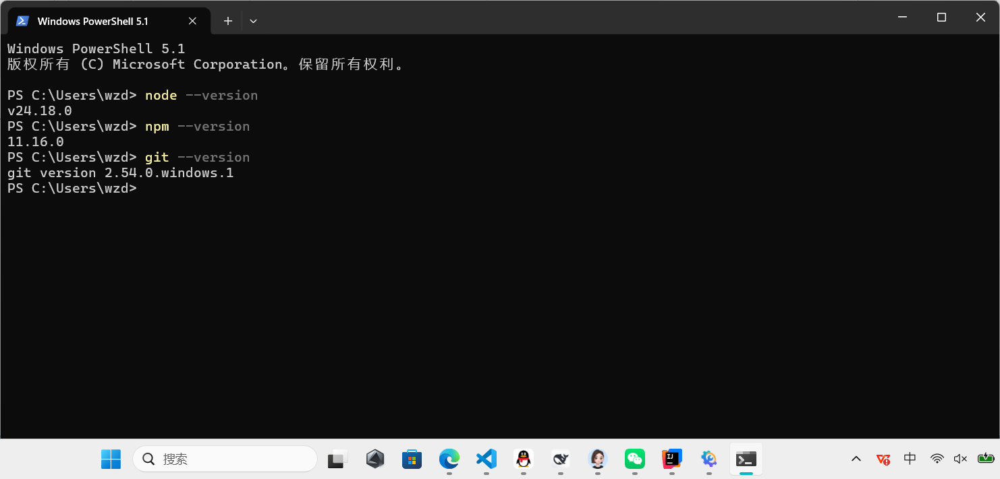
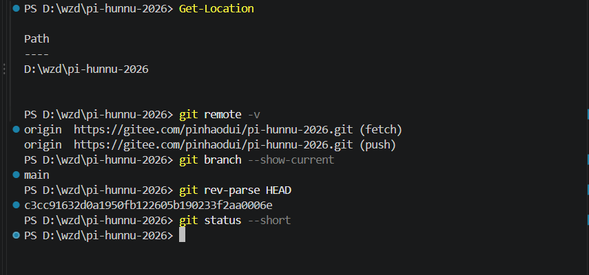
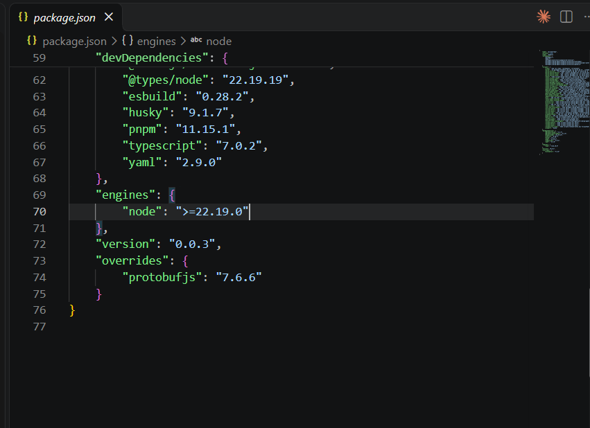
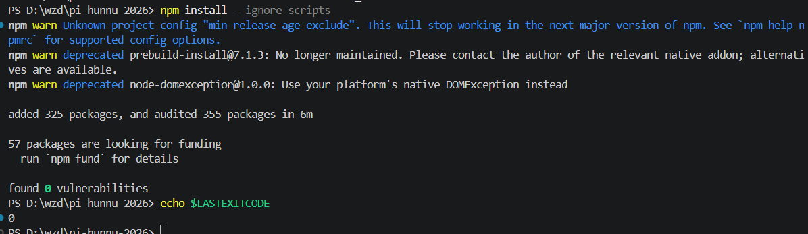
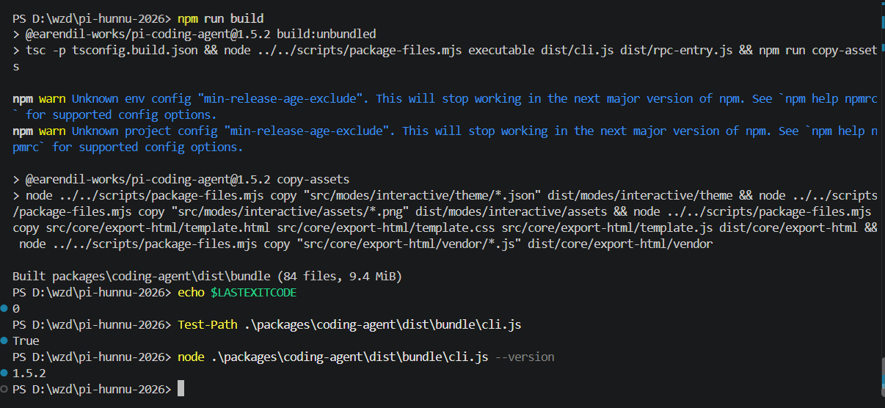
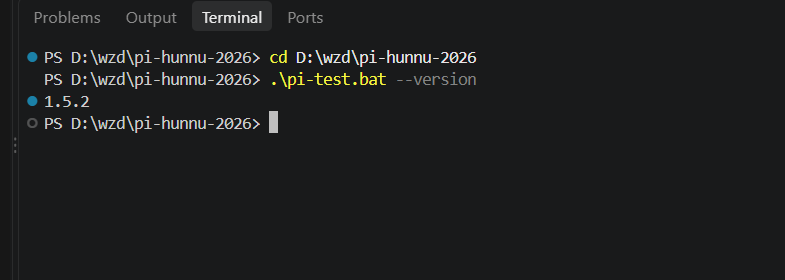
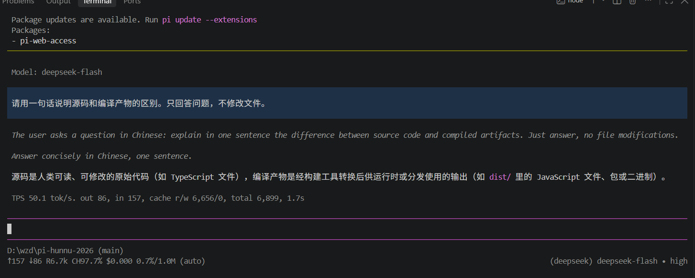

# 实践课 3：Pi Agent 源码获取、依赖安装与本地编译

## 一、实验环境

| 项目 | 实际值 |
| --- | --- |
| Node.js | v24.18.0 |
| npm | 11.16.0 |
| Git | 2.54.0.windows.1（安装目录 `D:\wzd\app\Git\cmd`） |
| 仓库地址 | https://gitee.com/pinhaodui/pi-hunnu-2026.git（本小组仓库） |
| 本地路径 | `D:\wzd\pi-hunnu-2026` |
| 分支 / 提交编号 | main / `3cc91632d0a1950fb122605b190233f2aa0006e` |
| 文本编辑器 | VS Code |

## 二、任务一：检查并准备开发工具

**操作**

在 PowerShell 中逐条执行：

```powershell
node --version
npm --version
git --version
```

**结果**：v24.18.0、11.16.0、git version 2.54.0.windows.1。




## 三、任务二：下载课程仓库源码
克隆完成后进入仓库根目录，执行确认命令：

```powershell
Get-Location
git remote -v
git branch --show-current
git rev-parse HEAD
git status --short
```



## 四、任务三：阅读配置，确认安装与编译的依据

**操作**

在 VS Code 中打开仓库根目录，重点查看 `README.md`、`package.json`、`package-lock.json`、`packages/` 以及 `packages/coding-agent/package.json`。

根 `package.json` 中与本次实验直接相关的两处：

```json
"engines": {
  "node": ">=22.19.0"
}
```



```json
"build": "cd packages/telemetry && npm run build && cd ../schema && npm run build && ... && cd ../coding-agent && npm run build"
```

.png)

## 五、任务四：安装项目依赖

**操作**

在仓库根目录执行：

```powershell
npm install --ignore-scripts
echo $LASTEXITCODE
```

**输出要点**：

- `added 325 packages, and audited 355 packages in 6m`
- `57 packages are looking for funding`
- `found 0 vulnerabilities`
- 退出码 0



## 六、任务五：本地编译与构建产物验证

**操作**

```powershell
npm run build
echo $LASTEXITCODE
Test-Path .\packages\coding-agent\dist\bundle\cli.js
node .\packages\coding-agent\dist\bundle\cli.js --version
```

**结果**：

- 构建日志依次经过 `telemetry`、`schema`、`chord`、`tui`、`codemode`、`mcp`、`ai`、`durable`、`env`、`agent`、`coding-agent`，最后停在 `coding-agent`，输出 `Built packages/coding-agent/dist/bundle (84 files, 9.4 MiB)`；
- 退出码 0；
- `Test-Path` 输出 `True`；
- 通过本地路径运行产物，输出 1.5.2。


## 七、任务六：启动本地源码版本并完成一次会话

**操作**

```powershell
.\pi-test.bat --version
.\pi-test.bat
```

第一条输出 1.5.2，与任务五中产物入口的版本一致。第二条进入交互界面，工作目录显示为 `D:\wzd\pi-hunnu-2026 (main)`，界面还提示"有新版本 1.6.1 可用"。



进入界面后发送：

> 请用一句话说明源码和编译产物的区别。只回答问题，不修改文件。

**实际收到的回复**：

> 源码是人写的、可读可改的原始代码（如 `src/*.ts`），编译产物是工具把源码转换出的、给机器或运行时直接用的结果（如 `dist/*.js`），通常不可读也不该手改。




## 九、问题回答

### Node.js 版本要求在哪里？

在根 `package.json` 的 `engines.node` 字段，值为 `>=22.19.0`。

### npm run build 实际从哪里读取命令？

从当前执行目录下 `package.json` 的 `scripts.build` 字段读取。npm 只负责按名字取脚本并交给 shell 执行，具体做什么由项目配置决定；本项目该字段是一串依次进入 12 个子包的 `cd ... && npm run build`，`&&` 保证前一步成功才继续。

### 本次如何确保运行的是本地源码？

使用仓库根目录的 `.\pi-test.bat` 启动，而不是直接输入 `pi`。该脚本经 `.ps1` 由 Node 加载 `packages/coding-agent/src/cli.ts` 源码入口；同时工作目录为 `D:\wzd\pi-hunnu-2026`，`--version` 输出的 1.5.2 与任务五中 `dist/bundle/cli.js` 的版本一致，界面还提示可更新到 1.6.1，说明当前运行的并非最新发布的全局版本。三处信息互相印证。

### 源码入口与 dist/bundle/cli.js 入口分别适合什么场景？

源码入口直接加载 TypeScript 源码，改动立即生效、无需重新构建，适合开发调试，例如边改边试、加日志、排查调用链；`dist/bundle/cli.js` 是编译打包后的成品，接近发布形态，适合验证构建结果、确认产物能独立运行，或分发到没有源码与工具链的环境。它的局限是只反映上一次构建的状态，源码改动后不重新构建就不会更新。
