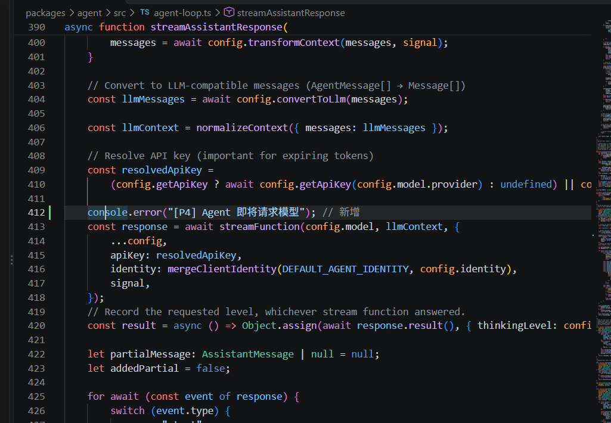
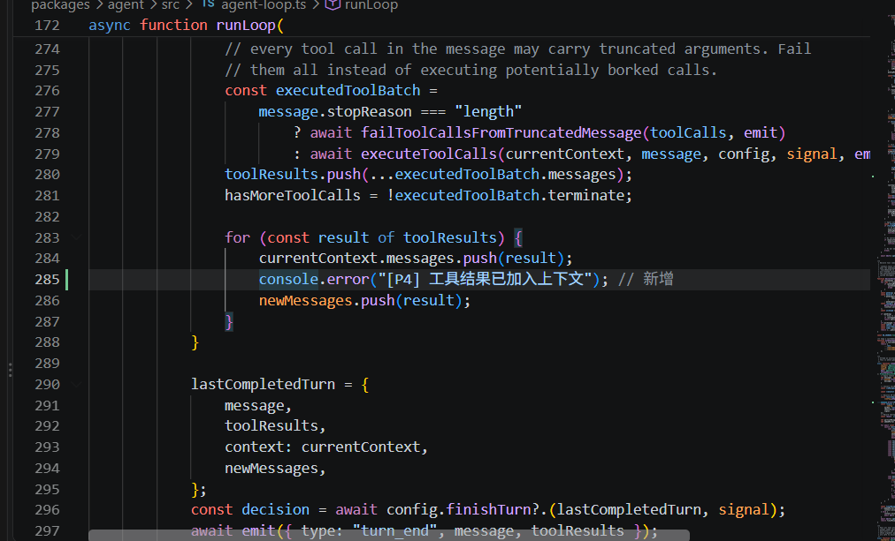
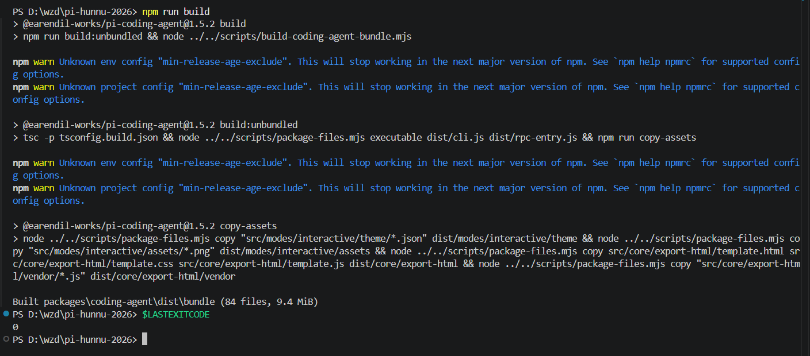
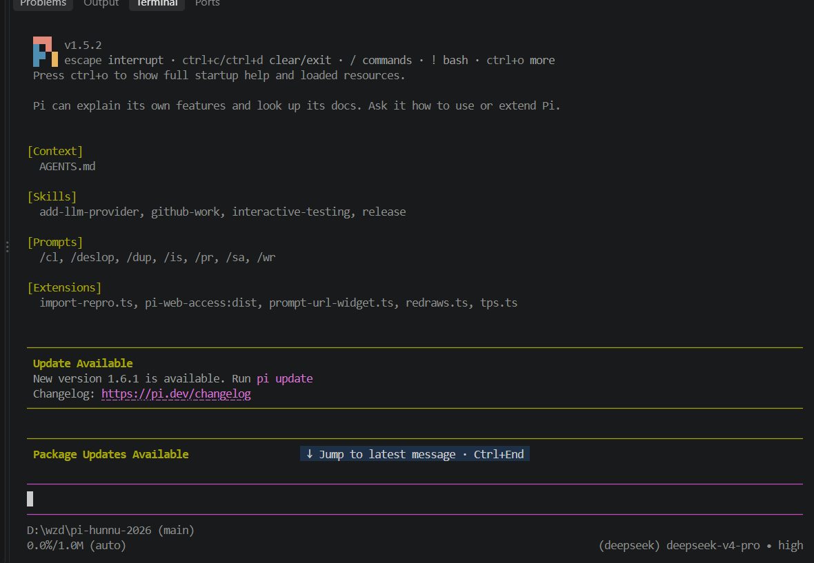

# 实践课 4：Pi Agent 的模型调用与运行流程

## 基本信息

| 项目 | 实际值 |
| --- | --- |
| 姓名拼音 | wangziduan |
| GitHub 登录名 | kilig036 |
| Node.js / npm | v24.18.0 / 11.16.0 |
| 小组代码仓库 | https://gitee.com/pinhaodui/pi-hunnu-2026.git |
| 小组仓库本地路径 | `D:\wzd\pi-hunnu-2026`（HEAD `c3cc91632d0a1950fb122605b190233f2aa0006e`） |
| 个人作业仓库 | https://github.com/kilig036/pi-agent-practice.git |
| 模型 | deepseek `deepseek-v4-pro` |
| 编辑器 | VS Code |

## 一、源码修改

修改文件：`packages/agent/src/agent-loop.ts`。本次共新增两行 `console.error` 日志，分别卡在"模型调用前"和"工具结果写入上下文后"两个位置。

### 1. 模型调用前打印日志

在 `const response = await streamFunction(...)` **上方**插入一行（源码现 413 行，对应教师演示版原 412 行）：

```ts
console.error("[P4] Agent 即将请求模型"); // 新增
const response = await streamFunction(config.model, llmContext, {
    ...
});
```

执行到这里时，Agent 准备把当前上下文交给模型调用函数。



### 2. 工具结果加入上下文后打印日志

在 `currentContext.messages.push(result);` **下方**插入一行（源码现 285 行，对应教师演示版原 284 行），日志写在 `for` 循环内，每写入一条工具结果打印一次：

```ts
for (const result of toolResults) {
    currentContext.messages.push(result);
    console.error("[P4] 工具结果已加入上下文"); // 新增
    newMessages.push(result);
}
```



## 二、重新编译并启动

### 1. 编译

在项目根目录（含根 `package.json`）执行：

```powershell
npm run build
$LASTEXITCODE
```

构建结束后返回命令提示符，`$LASTEXITCODE` 为 `0`，输出 `Built packages\coding-agent\dist\bundle (84 files, 9.4 MiB)`，编译成功。



### 2. 启动编译产物

```powershell
node .\packages\coding-agent\dist\cli.js
```

成功打开 Pi 交互界面，界面底部工作目录为 `D:\wzd\pi-hunnu-2026 (main)`，模型为 `deepseek deepseek-v4-pro`。



> 说明：`[P4]` 日志通过 stderr 输出，会与 Pi 的全屏交互界面混在一起。为完整记录日志顺序，启动时将 stderr 重定向到 `p4-debug.log`：
>
> ```powershell
> node .\packages\coding-agent\dist\cli.js 2> p4-debug.log
> Select-String -Path p4-debug.log -Pattern "\[P4\]"
> ```
>
> 报告中两次会话的日志顺序与条数以该日志文件记录为准；截图中已隐去授权信息。

## 三、对比两次运行

在项目根目录创建 `practice4.txt`，写入一行实验代号：

```text
PI-2026-1126
```

使用同一模型，分别在两个新会话中输入指令进行观察。

### 会话 A：直接问答

**输入指令：**

```text
请直接用一句话解释什么是 Git 分支。
```

**实际观察：**

| 项目 | 记录 |
| --- | --- |
| 是否调用工具 | 否（界面无工具执行记录） |
| `[P4] Agent 即将请求模型` | 1 条 |
| `[P4] 工具结果已加入上下文` | 0 条 |
| 模型调用轮次 | 1 轮 |

**Pi 最终回复：**

> Git 分支是 Git 中指向某个提交（commit）的可移动指针，让你在不影响主线的情况下并行开发、独立提交和合并代码。

模型无需借助工具即可直接回答，只发起一次模型请求，没有工具结果回灌。

![S5 会话 A 的指令、回复与 [P4] 日志](images/S5.png)

### 会话 B：读取文件

**输入指令：**

```text
请用 read 工具读取当前目录的 practice4.txt，并告诉我文件中的实验代号。
```

**实际观察（日志按出现顺序）：**

```text
[P4] Agent 即将请求模型
[P4] 工具结果已加入上下文
[P4] Agent 即将请求模型
```

| 项目 | 记录 |
| --- | --- |
| 是否调用工具 | 是，调用 `read` 工具读取 `practice4.txt` 一次 |
| `[P4] Agent 即将请求模型` | 2 条 |
| `[P4] 工具结果已加入上下文` | 1 条 |
| 模型调用轮次 | 2 轮 |

**工具记录：** `read practice4.txt`

**Pi 最终回复：**

> 实验代号是 PI-2026-1126。

Pi 正确读到了文件中的实验代号。

![S6 会话 B 的指令、read 记录、代号与 [P4] 日志](images/S6.png)
![S7 [P4] 日志](images/S7.png)
### 两次会话对比小结

| 会话 | 是否调工具 | 即将请求模型 | 工具结果已加入上下文 | 模型调用轮次 |
| --- | --- | --- | --- | --- |
| A 直接问答 | 否 | 1 条 | 0 条 | 1 轮 |
| B 读取文件 | 是（read） | 2 条 | 1 条 | 2 轮 |

## 四、运行流程分析

### 1. 谁实际读了文件？

实际读取文件的是 Agent 循环执行的 **`read` 工具**，而不是模型本身。模型并不直接访问磁盘文件：第一轮模型请求后，模型在回复中决定调用 `read` 工具，Agent 循环（`executeToolCalls`）真正执行读取操作，拿到 `practice4.txt` 的内容；模型只负责"决定调工具"和"根据工具结果组织回答"。

### 2. 下一轮模型请求多带了什么？

第一轮工具执行完成后，工具返回的文件内容（实验代号 `PI-2026-1126`）作为一条工具结果消息被 `push` 进 `currentContext.messages`，即"工具结果已加入上下文"。第二轮模型请求时，`streamFunction` 拿到的 `llmContext` 就**多带上了这条工具结果消息**；模型正是基于这份文件内容，才回答出实验代号。

### 3. 链路简图

```text
┌──────────────┐
│ coding-agent │  CLI 入口（dist/cli.js）
└──────┬───────┘
       │
       ▼
┌──────────────┐
│    agent     │  Agent 循环（agent-loop.ts）：决定调工具、执行工具、回灌结果
└──────┬───────┘
       │
       ▼
┌──────────────┐
│      ai      │  模型调用封装（streamFunction）
└──────┬───────┘
       │
       ▼
┌──────────────────┐
│ 远程模型服务      │  deepseek-v4-pro
└──────────────────┘
```

工具执行结果由 `agent` 层取回并塞回上下文，再进入下一轮模型请求；`coding-agent` 负责命令行交互，`ai` 层负责对接远程模型服务。
