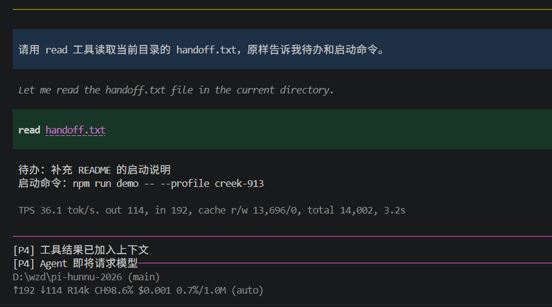
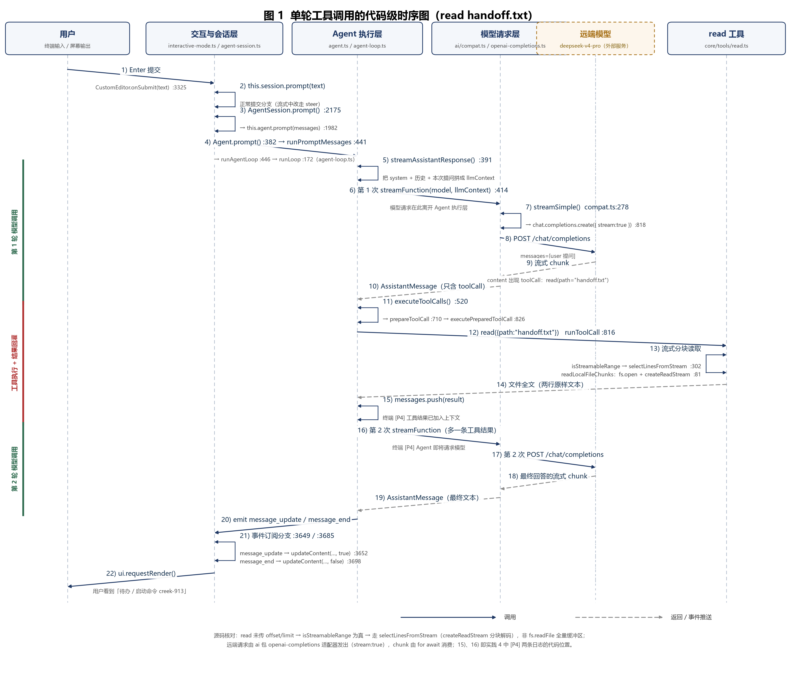
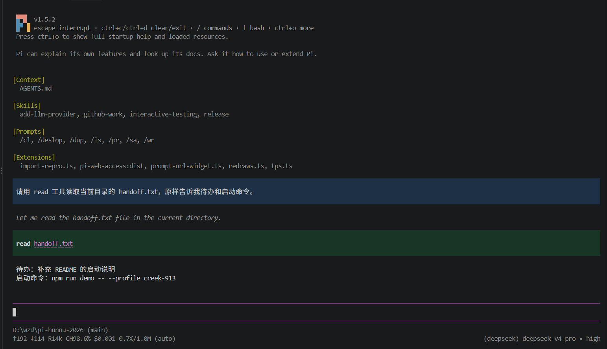
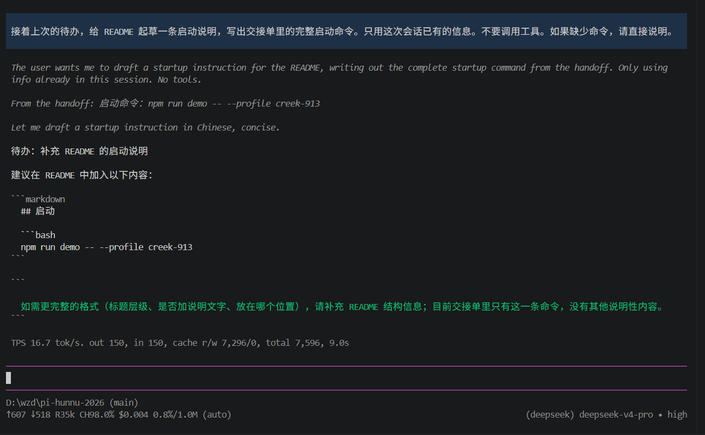
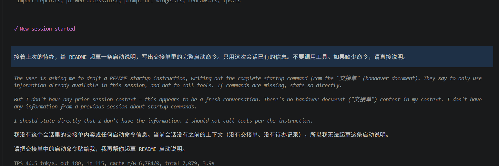
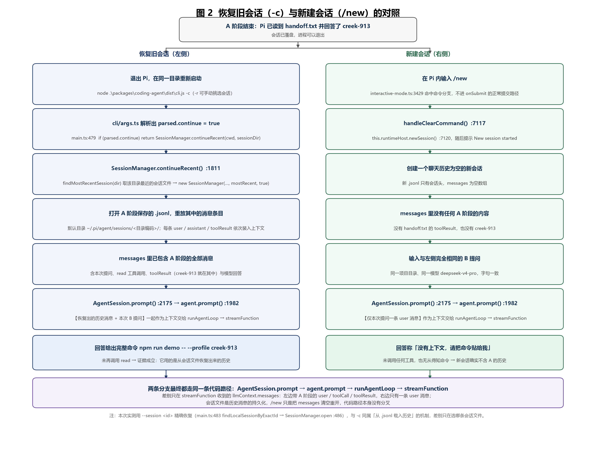

# 实践课 5：Pi Agent 的工具调用与会话恢复

## 基本信息

| 项目 | 实际值 |
| --- | --- |
| 姓名拼音 | wangziduan |
| GitHub 登录名 | kilig036 |
| Node.js | v22.23.2 |
| 小组代码仓库 | https://gitee.com/pinhaodui/pi-hunnu-2026.git |
| 小组仓库本地路径 | `D:\wzd\pi-hunnu-2026`（HEAD `c3cc91632d0a1950fb122605b190233f2aa0006e`） |
| 个人作业仓库 | https://github.com/kilig036/pi-agent-practice.git |
| 模型 | deepseek `deepseek-v4-pro` |
| 启动方式 | `node .\packages\coding-agent\dist\cli.js` |

> 说明：`packages/agent/src/agent-loop.ts` 仍保留实践 4 新增的两行 `[P4]` 日志，本次沿用它们观察模型调用轮次，未再改动源码。

---

## 一、A 阶段：单轮交互与工具调用

在项目根目录创建 `handoff.txt`，写入两行：

```text
待办：补充 README 的启动说明
启动命令：npm run demo -- --profile creek-913
```

启动本地构建的 Pi，在新会话中输入：

```text
请用 read 工具读取当前目录的 handoff.txt，原样告诉我待办和启动命令。
```

**实际观察：**

| 项目 | 记录 |
| --- | --- |
| 是否调用工具 | 是，调用 `read` 一次，参数为 `handoff.txt` |
| 工具调用前是否有思考文本 | 有，"Let me read the handoff.txt file in the current directory." |
| `[P4] Agent 即将请求模型` | 2 条 |
| `[P4] 工具结果已加入上下文` | 1 条 |
| 模型调用轮次 | 2 轮 |
| 最终回复 | 原样给出两行内容，含 `creek-913` |

一次用户输入（一轮交互）里发生了**两次模型调用**：第一次模型只决定调工具，第二次模型根据工具返回的文件内容组织回答。



---

## 二、图 1：单轮工具调用的代码级时序图



五条生命线按职责划分：用户、交互与会话层、Agent 执行层、模型请求层、`read` 工具；远端模型作为外部参与者单独标出，用来界定"适配器与远端服务"之间的请求与响应。箭头上的函数名与行号均已对照源码核对。

关键位置说明：

1. **输入入口**：`interactive-mode.ts` 中 `CustomEditor.onSubmit = async (text) => {…}`（赋值为 :3325），正常提交分支调用 `this.session.prompt(text)`，由 `AgentSession.prompt()`（:2175）转到 `this.agent.prompt(messages)`（:1982）。第 2、3 步是**同一层内的跨文件调用**（interactive-mode.ts → agent-session.ts），图中用自调用弧线标出。
2. **启动循环**：`Agent.prompt()`（`agent.ts:382`）→ `runPromptMessages()`（:441）→ `runAgentLoop()`（:446）→ `runLoop()`（`agent-loop.ts:172`）进入循环体。
3. **模型与文件边界**：循环内 `streamAssistantResponse()`（:391）调用 `streamFunction(config.model, llmContext, {…})`（:414），进入 `ai` 包的 `streamSimple()`（`compat.ts:278`）→ provider → `client.chat.completions.create(…, { stream: true })`（`api/openai-completions.ts:818`），响应由 `for await (const chunk of openaiStream)`（:544）消费。
4. **工具执行**：模型返回的 assistant 消息里带 `toolCall`（`name: "read"`），执行层 `executeToolCalls()`（:520）→ `prepareToolCall`（:710）→ `executePreparedToolCall`（:826）→ `runToolCall`（:816）。
5. **读取方式（按源码核对）**：本次提问没有给 `offset` / `limit`，`isStreamableRange(undefined, undefined)` 为真，因此走 `selectLinesFromStream(ops.createReadStream(path, { signal }))`（`tools/read.ts:302`），底层 `readLocalFileChunks` 用 `fs.open` + `handle.createReadStream({ end })`（:81-88）**流式分块**读取并逐块解码 UTF-8，**不是** `fs.readFile` 把整个文件读进缓冲区。只有传了负数或小数 `limit` 这类"不可流式"的范围，才退化到 `selectLinesFromBuffer(await ops.readFile(...))`（:308）。
6. **显示回复**：`read` 结果 `push` 进 `currentContext.messages`（即 `[P4] 工具结果已加入上下文`），第二次 `streamFunction`（即 `[P4] Agent 即将请求模型`）；回到 `interactive-mode.ts` 的事件分支，`case "message_update":`（:3649）调 `streamingComponent.updateContent(…, true)`（:3652）逐字刷新，`case "message_end":`（:3685）调 `updateContent(…, false)`（:3698）收尾，`ui.requestRender()` 后用户看到回复。

---

## 三、B 阶段：恢复会话与新建会话的对照

A 阶段已经让 Pi 读到并回答了 `creek-913`。接下来用**同一句话**分别在"恢复旧会话"和"新建会话"里提问：

```text
接着上次的待办，给 README 起草一条启动说明，写出交接单里的完整启动命令。
只用这次会话已有的信息。不要调用工具。如果缺少命令，请直接说明。
```

> 关于恢复命令：题目给的是 `-c`（`--continue`）。实验过程中先后开过多个会话，最近一条是 `/new` 之后的空会话，`-c` 会取"最近一次"而抓错目标。因此实际改用 `--session <id>` 精确恢复 A 阶段那条会话：`main.ts:483` 的 `findLocalSessionByExactId` 命中后调用 `SessionManager.open(path, sessionDir)`（:486）。它与 `-c` 走的是同一条"从 `.jsonl` 载入历史消息"的机制（`-c` 侧为 `main.ts:479` → `SessionManager.continueRecent`，`session-manager.ts:1811` → `findMostRecentSession`），差别只在"选哪条会话文件"。

### 1. 恢复旧会话（左侧分支）

```powershell
node .\packages\coding-agent\dist\cli.js --session 01a21867-39f8-736a-a489-b61c653252e2
```

进入后终端里能看到 A 阶段的聊天记录（提问、`read handoff.txt`、`creek-913`）。



提问后的实际回复（原文）：

> 待办：补充 README 的启动说明
>
> 建议在 README 中加入以下内容：
>
> ```markdown
> ## 启动
>
> ```bash
> npm run demo -- --profile creek-913
> ```
> ```
>
> 如需更完整的格式（标题层级、是否加说明文字、放在哪个位置），请补充 README 结构信息；目前交接单里只有这一条命令，没有其他说明性内容。

注意思考文本里的 "From the handoff: 启动命令: npm run demo -- --profile creek-913"——它直接从**已恢复的上下文**里取到了命令，**没有再次调用 `read`**。



### 2. 新建会话（右侧分支）

在同一界面输入 `/new`，得到 `New session started`，然后把完全相同的提问发出去。实际回复（原文）：

> 我没有这个会话里的交接单内容或任何启动命令信息。当前会话没有之前的上下文（没有交接单、没有待办记录），所以我无法起草这条启动说明。
>
> 请把交接单中的启动命令贴给我，我再帮你起草 README 启动说明。



### 3. 两次对照

| 项目 | 恢复旧会话（`--session`） | 新建会话（`/new`） |
| --- | --- | --- |
| 是否调用工具 | 否 | 否 |
| 回复里是否出现 `creek-913` | 是，完整写出 `npm run demo -- --profile creek-913` | 否 |
| 是否声明缺少信息 | 否，只补问 README 结构 | 是，"没有这个会话里的交接单内容" |
| 结论 | 使用了恢复出来的会话历史 | 历史为空，无从得知命令 |

恢复后的回答包含 A 阶段的完整命令且没有重新读文件，证据成立：它用的是从会话文件恢复出的历史消息，而不是磁盘上的 `handoff.txt`。

---

## 四、图 2：两条分支的对照



- **左（恢复）**：`--continue` 被解析为 `parsed.continue`（`main.ts:479`）→ `SessionManager.continueRecent()`（`session-manager.ts:1811`）→ `findMostRecentSession(dir)` 取到会话文件 → 重放其中的消息条目 → 上下文里已有 A 阶段的 user 提问、`read` 工具调用与 toolResult、模型回答 → 本次提问与它们一起交给 `streamFunction`。
- **右（新建）**：`/new` 命中 `interactive-mode.ts:3429` → `handleClearCommand()`（:7117）→ `this.runtimeHost.newSession()`（:7120）→ 新会话 `messages` 为空 → 只有一条 user 消息进入 `streamFunction`。
- **共同点**：两条分支最终都走 `AgentSession.prompt → agent.prompt → runAgentLoop → streamFunction`，代码路径没有分叉；**差异只在 `llmContext.messages` 里装了什么**。会话文件是历史消息的持久化，`/new` 只是把 `messages` 清空重开。

---
